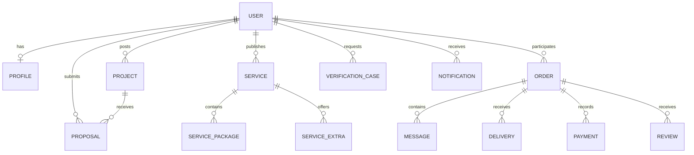

---
title: Data Models
type: conceptual-data-model
status: proposed
tags: [MIU, data-models, database]
---

# MIU Freelance Platform — Data Models

### Simulated order delivery records (24 October 2026)

Optional immutable `Order.deliveries` stores submission ID, handover text, fictional
sample IDs, submittedBy/submittedName/submittedAt and submitted/revision_requested/
accepted status. A reviewed delivery may carry revision text/actor/time or acceptance
actor/time. Resubmissions append rather than overwrite earlier handovers. Optional
`deliveryEvents` joins workspace activity. orderStore submitDelivery/requestRevision/
acceptDelivery methods guard current actors, lifecycle and latest delivery IDs,
using in-memory retry keys. Acceptance sets completedAt and completed status only;
agreed amounts, source/participant IDs and serviceTerms remain unchanged. These
records are not file storage, payment events or production audit/authentication.

### Phase 1 order collaboration state (24 October 2026)

`orderWorkspaceStore` stores per-order immutable requirements (text, sample IDs,
savedBy/savedAt, version), messages (order/sender IDs, safe display name and role,
text, sample IDs, createdAt), and workspace events (label, actor/time). It is
separate from orderStore and exposes stable getSnapshot/subscribe plus guarded
read/saveRequirements/sendMessage/actionError operations. Requirements use expected
versions; sends use sender/order-scoped retry keys. The current order lookup is
rechecked on every read/mutation. Samples carry metadata only, never files/URLs.
This is session-memory demonstration, not a secure backend or persistent messaging.
Order financial fields and historical serviceTerms are never rewritten here.

### Service-order confirmation snapshot (24 October 2026)

Service orders retain source/participant/package/extra IDs, agreedAmountEGP and
optional deliveryDays. New simulated orders also carry immutable `serviceTerms`:
service title/description, package name/scope/deliverables/price/days and selected
extra title/scope/price/days snapshots. Older fixture orders may omit those terms;
never substitute current listing text as historical terms. No payment credentials
or real personal files are stored. `createFromService` reads current service data
through an injected getter (avoiding an orderStore/serviceStore import cycle),
checks a reviewed-terms revision and uses client-scoped in-memory request keys for
idempotency. Revision strings are consistency checks, not secure authorization.

### Phase 1 service-management state adapter (24 October 2026)

`features/services/serviceStore.js` maintains immutable Service, ServicePackage and
ServiceExtra snapshots with `getSnapshot()` / `subscribe()`. `save(values, session,
existingId, submissionId)` validates and updates owned terms or creates one private
draft per creation token; `transition(id, session, action)` rechecks publish/pause/
remove eligibility. Default service selectors and reactive public/owner screens
use this adapter; explicit data arguments remain supported. IDs, ownership and
created timestamps cannot be overwritten through form fields. Linked order terms
are protected by blocking editing/removal, while pause preserves related records.
Runtime student adapters expose only ID/displayName. This is memory-only demo state,
not a database, authenticated API or persistent session. Existing contracts remain.

## 1. Purpose

Describe the conceptual records required by the platform.

These models are derived from SRS features but are not a finalized database schema or approved Prisma implementation.

## 2. Core Entities

**Current demo acceptance/order linkage:** proposalStore delegates acceptance to
projectStore, which rechecks owned open-project eligibility and creates a linked
order in orderStore before selecting the project. The proposal is then marked
accepted. A project can have one order in this demo; repeated acceptance of the
same proposal returns that order. Other proposals are not automatically rejected.
Order records retain project/proposal IDs and participant IDs and copy the agreed
price plus optional `deliveryDays` estimate. `awaiting_payment` does not mean any
payment or delivery-start event occurred. Default order selectors use live snapshots;
all changes are immutable and memory-only. Production transactions/persistence are
not implemented by this synchronous frontend workflow.

**Current Phase 1 project draft representation:** private in-memory drafts are
separate from public `Project` records. Each draft has `id`, `clientId`,
`status: "draft"`, `createdAt`, `updatedAt`, and `values`. `values` allowlists
the editor's text fields (`title`, `description`, `scope`, newline-separated
`deliverables`, `categoryId`, `budgetEGP`, `deadline`) and `requiredSkillIds`.
Incomplete budgets/dates remain form strings until publication validates and
normalizes them. Publishing preserves the ID and creation time and replaces the
draft with a complete open Project. Public edits use immutable in-memory overrides
merged by ID; original fixture records remain unchanged. Neither structure defines
a production persistence schema.

| Entity | Purpose |
|---|---|
| User | Account identity and status |
| Role | Assigned access role |
| Permission | Authorized action |
| Profile | Public/private profile details |
| Skill | Skill classification |
| PortfolioItem | Work sample |
| VerificationCase | Identity verification review |
| Project | Client-posted work |
| Proposal | Student offer for a project |
| Service | Student-published service |
| ServicePackage | Priced package |
| ServiceExtra | Optional addition |
| Order | Project or service engagement |
| OrderMilestone | Progress stage |
| Message | Order-related communication |
| Attachment | Protected or public file reference |
| Delivery | Submitted work |
| Review | Rating and feedback |
| Payment | Payment attempt or record |
| EscrowRecord | Simulated/approved escrow status history |
| Refund | Refund request and decision |
| Payout | Freelancer payout record |
| SupportTicket | Support request |
| Dispute | Formal disagreement |
| CommitteeCase | Assigned administrative review |
| Notification | User notification |
| AuditEvent | Administrative/system action history |
| AIFeedback | Feedback about an AI-assisted output |

## 3. User

Suggested attributes:
- `id`
- `email`
- `displayName`
- `role`
- `accountStatus`
- `verificationStatus`
- `createdAt`
- `updatedAt`

Production credentials must not be represented as plain-text password fields.

Task 02 keeps credential-free user/session records and a separate private in-memory password map in `features/auth/mockAuth.js`. Registered demo accounts add a normalized email to account metadata only. Runtime fixture emails reserve `<id>@example.test`; fixture source records remain unchanged. New account IDs use a collision-checked `registered_` sequence scoped to the provider's lifetime. Refresh removes registered accounts and password changes. This frontend-only demonstration does not define production credential storage. See [Authentication — Task 02](../06-MODULES/AUTHENTICATION.md#task-02-mock-authentication).

Task 01 adds the Phase 1 `MockUser` and `MockSession` JSDoc contracts in `frontend/src/features/auth/session.js`, with fictional accounts in `frontend/src/data/fixtures/users.js`. Existing marketplace participant IDs are preserved. Account activity and verification status are separate; the session is memory-only. See [Authentication — Task 01](../06-MODULES/AUTHENTICATION.md#task-01-routingsession-foundation) for the vocabulary and provider interface. This does not change Member 2's marketplace contracts or define a production user schema.

## 4. Profile

Suggested attributes:
- `id`
- `userId`
- `headline`
- `bio`
- `skills`
- `availability`
- `portfolioItems`
- `profileImage`
- `ratingSummary`

Public profiles must not expose sensitive identity-verification images.

## 5. Project

Suggested attributes:
- `id`
- `clientId`
- `title`
- `description`
- `scope` (optional detailed project brief in Phase 1 mock records)
- `deliverables` (optional list of expected outputs)
- `requiredSkills`
- `budgetEGP`
- `deadline`
- `status`
- `createdAt`

## 6. Proposal

Suggested attributes:
- `id`
- `projectId`
- `studentId`
- `priceEGP`
- `deliveryTime`
- `coverMessage`
- `attachments`
- `status`

## 7. Service and Package

### Service
- `id`
- `studentId`
- `title`
- `description`
- `category`
- `status`

### Package
- `id`
- `serviceId`
- `name`
- `priceEGP`
- `deliveryTime`
- `includedFeatures`

### Extra
- `id`
- `serviceId`
- `title`
- `additionalPriceEGP`
- `additionalTime`

Package names and exact pricing rules remain subject to later decisions.

## 8. Order

Suggested attributes:
- `id`
- `clientId`
- `studentId`
- `sourceType` — project or service
- `sourceId`
- `agreedAmountEGP`
- `status`
- `createdAt`
- `completedAt`

Each order must identify its originating marketplace flow.

## 9. Payment and Escrow

### Payment
- `id`
- `orderId`
- `amountEGP`
- `providerReference`
- `status`
- `createdAt`

### EscrowRecord
- `id`
- `orderId`
- `amountEGP`
- `status`
- `recordedAt`

### Refund
- `id`
- `orderId`
- `amountEGP`
- `reason`
- `status`

### Payout
- `id`
- `orderId`
- `amountEGP`
- `status`

These entities represent conceptual future records. Phase 1 uses mock data.

**Money storage recommendation:** Use exact decimal or integer minor-unit values in the eventual backend, rather than floating-point arithmetic. This is an engineering recommendation, not a finalized database decision.

## 10. VerificationCase

Suggested attributes:
- `id`
- `userId`
- `documentType`
- `status`
- `reviewerId`
- `decisionReason`
- `createdAt`
- `reviewedAt`

Protected evidence should be managed separately from public profile information.

## 11. CommitteeCase

Suggested attributes:
- `id`
- `committeeType`
- `relatedEntityType`
- `relatedEntityId`
- `assignedTo`
- `status`
- `priority`
- `decision`
- `decisionReason`

## 12. AuditEvent

Suggested attributes:
- `id`
- `actorId`
- `action`
- `entityType`
- `entityId`
- `timestamp`
- `reason`

Audit records should support traceability and appropriate retention.

## 13. Conceptual Relationships

This diagram is conceptual and does not define database constraints.

## 14. Data Integrity Rules

- Use stable unique identifiers.
- Enforce valid references between records.
- Record status transitions consistently.
- Use EGP for all monetary records.
- Maintain transaction history.
- Avoid duplicate critical financial operations.
- Restrict sensitive evidence access.
- Preserve meaningful audit history.

## 15. Phase 1 Fixture Requirements

Mock data should include:
- Students and clients
- Super Admin and five committee roles
- Open and completed projects
- Multiple proposal statuses
- Published and paused services
- Different service packages
- Orders with realistic progress states
- Sandbox transactions
- Verification cases
- Disputes and support tickets
- Reviews and notifications

Use fictional identities only.

### Current Member 2 frontend foundation

The frontend now has JSDoc marketplace contracts in `frontend/src/data/contracts.js`,
provisional status constants, and a small deterministic fixture in
`frontend/src/data/fixtures/marketplace.js`. It demonstrates an open project,
an accepted proposal linked to a project order, and a service package with an
extra linked to a service order. The participant summaries are fictional
integration references, not full account or profile records. The fixture is
checked for broken references and EGP totals by local tests. Marketplace
selectors support text, category, skill, and status filtering. Shared EGP and
date formatters provide consistent display values. These are mock records
only; no marketplace screen, persistence, payment, or escrow is implemented
by this foundation.

## Related Documents

- [SRS](../01-PROJECT/SRS.md)
- [Business Rules](../02-REQUIREMENTS/BUSINESS_RULES.md)
- [API Contracts](API_CONTRACTS.md)

## Freelancer discovery read model — Phase 1

The directory derives `{ id, displayName, services, skills, startingPriceEGP }` from published services and the marketplace public participant adapter. `services` contains matching `{ service, package }` pairs; `skills` contains their declared tags; `startingPriceEGP` is the minimum valid matching package price or `null`. It stores no profile edits, hourly rates, ratings, availability, identity evidence or authentication fields. Filters apply to the same service before grouping by provider. See [Freelancer Discovery](../06-MODULES/FREELANCER_DISCOVERY.md) for the pending Member 5 identity dependency.
