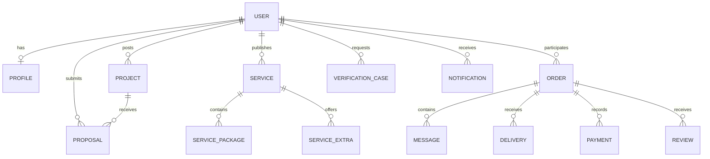

---
title: Data Models
type: conceptual-data-model
status: proposed
tags: [MIU, data-models, database]
---

# MIU Freelance Platform — Data Models

## 1. Purpose

Describe the conceptual records required by the platform.

These models are derived from SRS features but are not a finalized database schema or approved Prisma implementation.

## 2. Core Entities

| Entity | Purpose |
|---|---|
| User | Account identity and status |
| Role | Assigned access role |
| Permission | Authorized action |
| Profile | Public/private profile details |
| Skill | Skill classification |
| PortfolioItem | Work sample |
| VerificationCase | Identity verification review |
| Project | Client-posted work |
| Proposal | Student offer for a project |
| Service | Student-published service |
| ServicePackage | Priced package |
| ServiceExtra | Optional addition |
| Order | Project or service engagement |
| OrderMilestone | Progress stage |
| Message | Order-related communication |
| Attachment | Protected or public file reference |
| Delivery | Submitted work |
| Review | Rating and feedback |
| Payment | Payment attempt or record |
| EscrowRecord | Simulated/approved escrow status history |
| Refund | Refund request and decision |
| Payout | Freelancer payout record |
| SupportTicket | Support request |
| Dispute | Formal disagreement |
| CommitteeCase | Assigned administrative review |
| Notification | User notification |
| AuditEvent | Administrative/system action history |
| AIFeedback | Feedback about an AI-assisted output |

## 3. User

Suggested attributes:
- `id`
- `email`
- `displayName`
- `role`
- `accountStatus`
- `verificationStatus`
- `createdAt`
- `updatedAt`

Production credentials must not be represented as plain-text password fields.

## 4. Profile

Suggested attributes:
- `id`
- `userId`
- `headline`
- `bio`
- `skills`
- `availability`
- `portfolioItems`
- `profileImage`
- `ratingSummary`

Public profiles must not expose sensitive identity-verification images.

## 5. Project

Suggested attributes:
- `id`
- `clientId`
- `title`
- `description`
- `requiredSkills`
- `budgetEGP`
- `deadline`
- `status`
- `createdAt`

## 6. Proposal

Suggested attributes:
- `id`
- `projectId`
- `studentId`
- `priceEGP`
- `deliveryTime`
- `coverMessage`
- `attachments`
- `status`

## 7. Service and Package

### Service
- `id`
- `studentId`
- `title`
- `description`
- `category`
- `status`

### Package
- `id`
- `serviceId`
- `name`
- `priceEGP`
- `deliveryTime`
- `includedFeatures`

### Extra
- `id`
- `serviceId`
- `title`
- `additionalPriceEGP`
- `additionalTime`

Package names and exact pricing rules remain subject to later decisions.

## 8. Order

Suggested attributes:
- `id`
- `clientId`
- `studentId`
- `sourceType` — project or service
- `sourceId`
- `agreedAmountEGP`
- `status`
- `createdAt`
- `completedAt`

Each order must identify its originating marketplace flow.

## 9. Payment and Escrow

### Payment
- `id`
- `orderId`
- `amountEGP`
- `providerReference`
- `status`
- `createdAt`

### EscrowRecord
- `id`
- `orderId`
- `amountEGP`
- `status`
- `recordedAt`

### Refund
- `id`
- `orderId`
- `amountEGP`
- `reason`
- `status`

### Payout
- `id`
- `orderId`
- `amountEGP`
- `status`

These entities represent conceptual future records. Phase 1 uses mock data.

**Money storage recommendation:** Use exact decimal or integer minor-unit values in the eventual backend, rather than floating-point arithmetic. This is an engineering recommendation, not a finalized database decision.

## 10. VerificationCase

Suggested attributes:
- `id`
- `userId`
- `documentType`
- `status`
- `reviewerId`
- `decisionReason`
- `createdAt`
- `reviewedAt`

Protected evidence should be managed separately from public profile information.

## 11. CommitteeCase

Suggested attributes:
- `id`
- `committeeType`
- `relatedEntityType`
- `relatedEntityId`
- `assignedTo`
- `status`
- `priority`
- `decision`
- `decisionReason`

## 12. AuditEvent

Suggested attributes:
- `id`
- `actorId`
- `action`
- `entityType`
- `entityId`
- `timestamp`
- `reason`

Audit records should support traceability and appropriate retention.

## 13. Conceptual Relationships

This diagram is conceptual and does not define database constraints.

## 14. Data Integrity Rules

- Use stable unique identifiers.
- Enforce valid references between records.
- Record status transitions consistently.
- Use EGP for all monetary records.
- Maintain transaction history.
- Avoid duplicate critical financial operations.
- Restrict sensitive evidence access.
- Preserve meaningful audit history.

## 15. Phase 1 Fixture Requirements

Mock data should include:
- Students and clients
- Super Admin and five committee roles
- Open and completed projects
- Multiple proposal statuses
- Published and paused services
- Different service packages
- Orders with realistic progress states
- Sandbox transactions
- Verification cases
- Disputes and support tickets
- Reviews and notifications

Use fictional identities only.

### Current Member 2 frontend foundation

The frontend now has JSDoc marketplace contracts in `frontend/src/data/contracts.js`,
provisional status constants, and a small deterministic fixture in
`frontend/src/data/fixtures/marketplace.js`. It demonstrates an open project,
an accepted proposal linked to a project order, and a service package with an
extra linked to a service order. The participant summaries are fictional
integration references, not full account or profile records. The fixture is
checked for broken references and EGP totals by a local test. These are mock
records only; no marketplace screen, persistence, payment, or escrow is
implemented by this foundation.

## Related Documents

- [SRS](../01-PROJECT/SRS.md)
- [Business Rules](../02-REQUIREMENTS/BUSINESS_RULES.md)
- [API Contracts](API_CONTRACTS.md)
