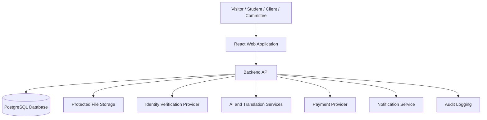
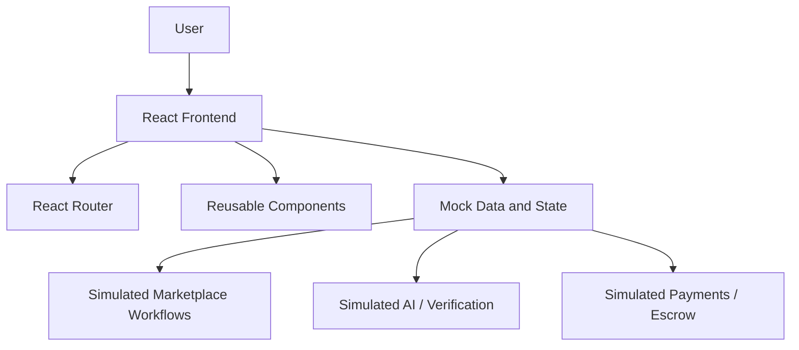

---
title: System Architecture
type: architecture
status: proposed
tags: [MIU, architecture]
---

# MIU Freelance Platform — System Architecture

## 1. Purpose

Describe the planned architecture of the complete platform and its relationship to the Phase 1 frontend.

This document is a technical proposal and does not claim that the backend or external services already exist.

## 2. Architecture Overview

The intended platform is a web-first application consisting of:

1. React frontend
2. Backend application/API
3. Persistent database
4. Protected file storage
5. External identity verification services
6. AI and translation services
7. Payment-provider integration
8. Email/notification services
9. Administrative monitoring and audit records

## 3. Conceptual Architecture

This diagram describes the intended complete system, not the Phase 1 implementation.

## 4. Phase 1 Architecture

Phase 1 must not be mistaken for a production service.

## 5. Proposed Technology Stack

### Frontend
- React
- JavaScript
- Vite
- React Router
- Tailwind CSS v4
- Lucide React
- React Context where useful

### Backend — Planned
- Node.js
- Express.js

### Database — Planned
- PostgreSQL
- Prisma

### Mobile — Later
- Capacitor

Final product and provider selections require technical review.

## 6. Logical Modules

### Identity and Access
Accounts, authentication, roles, permissions, verification status.

### Marketplace
Projects, proposals, services, packages, skills, recommendations.

### Orders
Orders, milestones, messages, attachments, deliveries, revisions.

### Finance
Payments, escrow statuses, fees, refunds, payouts, receipts.

### Reputation
Profiles, portfolios, ratings, reviews.

### Governance
Admin accounts, committees, moderation, support, disputes, audit events.

### AI and Assistance
Matching, chatbot, translation, moderation assistance, quality feedback.

## 7. Security Architecture

Production requirements include:
- Secure authentication
- Server-side authorization
- Encrypted communication
- Protected secrets
- Secure storage of sensitive files
- Administrative audit logs
- Data retention controls
- Input validation
- Backup and recovery
- Separation of development/test/production environments

Identity and financial records require especially careful access controls.

## 8. External Integration Principles

External services should be accessed through backend-controlled integrations where sensitive credentials or personal information are involved.

Provider integrations should:
- Keep secrets off the client
- Handle errors and retries
- Record required audit events
- Support sandbox/testing environments
- Avoid assuming provider success
- Preserve traceable status changes

## 9. Reliability

For the later production system:
- Prevent duplicate payment actions
- Use idempotent operations for critical state changes
- Preserve order and transaction history
- Define retry and recovery procedures
- Record unexpected failures

## 10. Deployment Direction

Exact hosting and deployment choices remain undecided.

Any future deployment should include:
- HTTPS
- Environment separation
- Database backups
- Monitoring
- Secret management
- Access-controlled storage
- Release rollback planning

## Related Documents

- [Frontend Architecture](FRONTEND_ARCHITECTURE.md)
- [Data Models](DATA_MODELS.md)
- [API Contracts](API_CONTRACTS.md)
- [SRS](../01-PROJECT/SRS.md)
