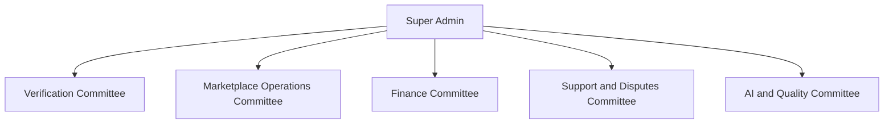

---
title: Administration and Committees
type: module
status: baseline
tags: [MIU, admin, committees]
---

# Administration and Committees

## 1. Purpose

Define the administrative organization of the MIU Freelance Platform.

**SRS references:** FR-A01–FR-A10, FR-VC01–FR-VC05, FR-MO01–FR-MO05, FR-FC01–FR-FC05, FR-SD01–FR-SD05, FR-AQ01–FR-AQ05.

## 2. Governance Structure

## 3. Super Admin

The Super Admin can:
- View platform activity summaries
- Manage student/client account status
- Create committee accounts
- Assign committee roles
- Change permitted role assignments
- Suspend or reactivate committee accounts
- Review escalations
- View audit records
- Make final decisions on cases beyond committee authority
- Manage permitted platform settings

## 4. Committee Account Provisioning

**Confirmed rule:** Committee members cannot self-register.

Workflow:
1. Super Admin opens committee management.
2. Super Admin enters member information.
3. Super Admin assigns one of five committee roles.
4. System creates the account.
5. Member receives authorized login/activation instructions.
6. Member logs in.
7. Assigned committee dashboard opens.

Activation emails and password setup require an approved future implementation.

## 5. Verification Committee

Responsibilities:
- Review pending identity cases
- Examine permitted face/liveness results
- Review MIU or government ID evidence
- Approve or reject
- Request resubmission
- Record decision reasons

## 6. Marketplace Operations Committee

Responsibilities:
- Review projects
- Review services
- Review proposals
- Review reported comments and reviews
- Handle marketplace content reports
- Review automated moderation flags
- Make permitted human moderation decisions
- Escalate exceptional cases

## 7. Finance Committee

Responsibilities:
- View sandbox transaction records
- Review escrow statuses
- Review refunds and payouts
- Review platform fees
- Investigate financial exceptions
- Perform permitted sandbox actions
- Record reasons and escalate unauthorized actions

## 8. Support and Disputes Committee

Responsibilities:
- Receive support tickets
- Review disputes
- Examine order history and evidence
- Communicate with involved users
- Record notes
- Resolve permitted cases
- Escalate financial or final decisions

## 9. AI and Quality Committee

Responsibilities:
- Review matching performance
- Review chatbot problems
- Review moderation quality
- Investigate reported AI errors
- Record quality findings
- Assign or escalate unresolved issues

## 10. Dashboard Structure

Every committee dashboard should offer, where relevant:
- Summary metrics
- Assigned work queue
- Search and filters
- Case details
- Status indicators
- Allowed actions
- Decision notes
- Relevant audit history
- Escalation mechanism

Shared visual components should be reused across committees.

## 11. Role-Based Data Restrictions

Examples:
- Verification members should not access unrelated payment data.
- Finance members should not access unnecessary face/ID evidence.
- Support members should not manage platform-wide permissions.
- AI and Quality reviewers should access only data relevant to quality work.
- Super Admin permissions must follow approved governance rules.

## 12. Audit Requirements

Record relevant:
- Actor
- Action
- Date/time
- Target
- Reason
- Result

Records should be accessible only to authorized roles.

## 13. Phase 1 Demonstration

Use mock accounts, fictional cases, and simulated decisions.

Demonstrate:
- Committee account creation
- Role-specific login
- Five committee dashboards
- Case review
- Decision recording
- Escalation
- Restricted navigation

## 14. Open Decisions

The Super Admin frontend preview is documented in
[Super Admin Dashboard](SUPER_ADMIN_DASHBOARD.md). Other committee screens remain
the shared router's explicitly labeled placeholders in this checkout.

- Final financial approval thresholds
- Escalation deadlines
- Committee membership limits
- Exact assignment policies
- Multi-level approval requirements
- Audit retention policies

## Related Documents

- [Roles and Permissions](../02-REQUIREMENTS/USER_ROLES_AND_PERMISSIONS.md)
- [Business Rules](../02-REQUIREMENTS/BUSINESS_RULES.md)
- [Payments and Escrow](PAYMENTS_AND_ESCROW.md)
- [Verification](VERIFICATION.md)
