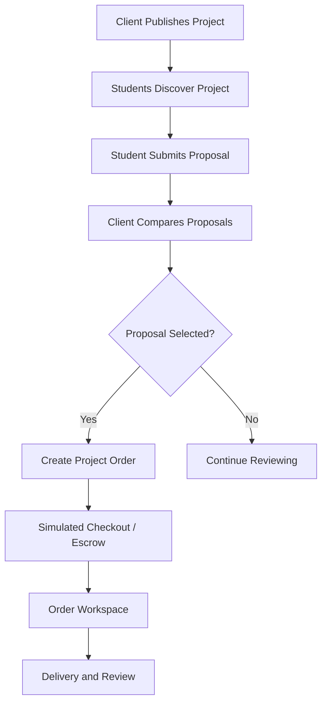

# Projects and Proposals

## 1. Purpose

Support the project-based freelancing model inspired by Mostaql.

Clients publish projects and student freelancers compete through proposals.

**SRS references:** FR-S04–FR-S06, FR-C04–FR-C06.

## 2. Client Project Management

Clients can:

- Create a project
- Edit a project
- Preview a project
- Publish a project
- Close a project
- Cancel a project when permitted
- Review incoming proposals

## 3. Project Information

A project should include:

- Title
- Description
- Category/required skills
- Scope and expected deliverables
- Budget in EGP
- Deadline
- Publication status

Additional fields may be defined during UI review.

## 4. Student Discovery

Students can:

- Browse projects
- Search by text
- Filter relevant results
- Open project details
- View planned recommendations
- Submit a proposal if eligible

## 5. Proposal Submission

The first P-08 increment registers `/projects/:projectId/propose` for active
student accounts only. Open project details provide a Submit proposal entry.
Visitors go through the shared login flow; other roles are denied. Missing and
non-open projects show recovery states. Pending verification is explained per
BR-06. This entry screen does not yet implement the form, attachments, or mock
submission; FR-S05 is not complete.

A proposal contains:

- Proposed price in EGP
- Delivery time
- Cover message
- Permitted attachments

Validation should cover required fields, valid amounts, and applicable project state.

## 6. Proposal Management

Students can:

- View submitted proposals
- Check proposal status
- Edit a proposal while allowed
- Withdraw a proposal while allowed

## 7. Client Proposal Review

Clients can:

- View incoming proposals
- Compare price and delivery time
- Review the student profile
- Shortlist proposals
- Accept or reject proposals

Acceptance should lead into the appropriate project order workflow.

## 8. Proposed Workflow

## 9. Pricing Rule

All project budgets and proposal prices are in EGP.

Whether the platform blocks proposals outside a client's specified budget or merely displays a warning is not yet finalized.

## 10. Potential Statuses

Suggested workflow labels:

- Draft
- Open
- Under Review
- Selected
- Closed
- Cancelled

Proposal status may include:

- Submitted
- Shortlisted
- Accepted
- Rejected
- Withdrawn

These exact enums require approval before persistence design.

## 11. Phase 1 Expectations

Demonstrate:

- Browse/search/filter
- Project details
- Post/edit project
- Proposal form
- Proposal list
- Client comparison
- Mock acceptance
- Transition to a mock project order

**Current frontend status (22 October 2026):** The projects catalogue has a
standalone responsive React preview. Its current visual direction combines
MIU branding with a stronger freelancing-marketplace layout: a discovery hero,
prominent search, category tiles, a filter sidebar, a highlighted opportunity,
and project cards. A muted page canvas, stronger card borders, and tinted
budget panels distinguish the white surfaces and their controls.
It shows fictional open projects, category/budget/skill
filters, sorting, active filter chips, an empty state, brief disclosure, and
temporary saved-item state with a saved-only filter. Desktop cards separate
the brief from budget/deadline actions; inline brief expansion also works on
mobile. Category tiles use restrained accent colors and a selected checkmark.
Mobile filters are collapsible. Header links jump to discovery, results, or
saved results; these are in-page links, not new routes. The latest opportunity
is highlighted only in the default unfiltered newest-first view. Saving is
not persistent and updates a screen-reader status message.
The project details preview (P-07) now shows the selected fictional project's
summary, detailed scope, expected deliverables, client, category, required
skills, EGP budget, posted date, deadline, and open state. The detailed fields
are optional so older mock records can still show their summary as the brief.
The page distinguishes an open project from one no longer accepting proposals,
and handles a missing project ID. The catalogue's View project action navigates
to `/projects/:projectId`, and the details page returns to `/projects`. Returning
currently resets catalogue filters and saved items because this preview state is
local and non-persistent. Proposal actions and their role restrictions are still pending.
Automated render tests cover open, unavailable, and missing project states.
The P-07 SRS screenshot is still pending a capture of the actual details screen.

### Project Details follow-up (P-07)

- [x] Show distinct fictional scope and deliverables, with a summary fallback for older mock records.
- [x] Test open, unavailable, and missing project rendering; validate optional brief fields in fixtures.
- [ ] Visually review the actual details screen at desktop and mobile widths, including keyboard focus; capture its P-07 SRS screenshot. Deferred by the team on 23 October 2026.
- [x] Connect `/projects/:projectId` and deep-link/back navigation through Member 1's shared router.
- [ ] Connect student-only proposal entry when the separate P-08 proposal screen and mock role state exist. The current notice must not be presented as a working submission action.

The discovery preview is organized in `frontend/src/features/projects/`:
`ProjectsCatalogue.jsx` owns search, filtering, sorting, and temporary save
state; `catalogueModel.js` holds catalogue options and lookup data;
`ProjectsHero.jsx`, `CategoryCard.jsx`, `FilterPanel.jsx`, and
`ProjectCard.jsx` render the feature-specific interface. As of 23 October 2026,
the shared router mounts `ProjectsCatalogue` at the public `/projects` route
and `ProjectDetails` at `/projects/:projectId`, using their full-width marketplace
shells. Rendered-route tests guard this integration. Proposal submission remains
separate Member 2 work.

## 12. Dependencies

- Authentication
- Student/client roles
- Profiles
- Skills matching
- Orders
- Payments and escrow
- Notifications
- Marketplace moderation

## Related Documents

- [Services and Orders](SERVICES_AND_ORDERS.md)
- [Payments and Escrow](PAYMENTS_AND_ESCROW.md)
- [Business Rules](../02-REQUIREMENTS/BUSINESS_RULES.md)
