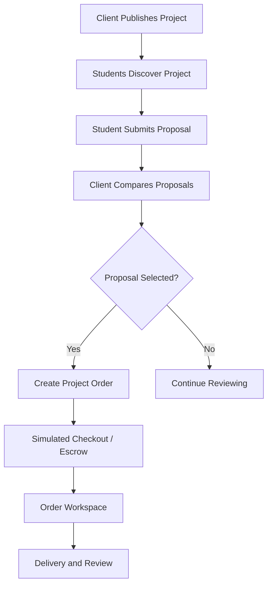

# Projects and Proposals

## 1. Purpose

Support the project-based freelancing model inspired by Mostaql.

Clients publish projects and student freelancers compete through proposals.

**SRS references:** FR-S04–FR-S06, FR-C04–FR-C06.

## 2. Client Project Management

### Current creation demo (24 October 2026; FR-C04 / P-16)

`/client/projects/new` is protected by the existing active-client route guard.
The catalogue's Post a project action opens it. The marketplace-styled form collects
title, description, category, listed skills, scope, newline-separated deliverables,
positive EGP budget (maximum two decimals), and a valid deadline after today.
Required fields and text-length limits are checked before preview and again at
publication. Preview retains editable form values; publishing uses the current
session's client ID rather than caller-provided ownership or status.

Publication is explicitly simulated: an immutable, in-memory open Project joins
catalogue queries, details, and proposal lookup until refresh. Repeating a publish
request for the same client/form token returns the same project. Fixtures are not
mutated. Unsaved form values clear on route exit or account switch. Private drafts
can now be saved in memory and reopened from `/client/projects`; refresh clears
both drafts and published changes. No production publication is implemented.

The current session contract has no MIU/external-client discriminator. As a
temporary conservative demo restriction, all clients need `approved` verification
to publish; active pending clients can write and preview. This is not an approved
production rule for MIU clients. Nile Studio (`client_001`) now represents a
fictional approved client scenario, not an actual verification decision. Member 1
must supply the account-origin distinction before applying FR-C02 precisely.

Automated validation/store and rendered-route checks cover creation and integration.
Browser checks of preview/edit/publish, error focus, account switching, keyboard
use, and desktop/mobile appearance remain pending.

### Drafts and owned edits (FR-C04 / P-16)

`/client/projects` lists only the active client's fixture/demo projects and private
drafts. `/client/projects/:projectId/edit` reopens owned drafts or open projects.
The store rechecks account activity, ownership and editable status on every save.
Unknown, other-client, selected, closed and cancelled projects show a generic
recovery state without exposing their brief in the editor. Restricting published
edits to open projects is a demo safeguard, not a finalized production edit policy.

Save draft accepts incomplete form strings and missing fields, while validating
types, text limits and supplied category/skill IDs. Drafts are separate private
records, excluded from public selectors, catalogue and details. Publishing a draft
requires full validation and approved demo verification; it retains the draft ID
and creation timestamp and removes the private draft representation.

Published edits require full validation and approved demo verification. They retain
ownership, ID, original creation time and open status. Memory-only overrides replace
the original project in discovery, details and proposal lookups without duplicate
cards or fixture mutation. Unsaved changes to an open brief never replace its public
version. Pending clients can save drafts but cannot publish or save public edits.

Clients can:

- Create a project
- Edit a project
- Preview a project
- Publish a project
- Close a project
- Cancel a project when permitted
- Review incoming proposals

### Close and cancel demo projects (FR-C04)

My projects now provides confirmation dialogs for Close and Cancel. Close changes
an owned open project to `closed`; Cancel changes an owned open or closed project
to `cancelled`. Both recheck active client ownership, the current project status,
and linked commitments at confirmation. Any linked project order (including unpaid
or completed examples) or accepted proposal blocks both actions. These are
conservative demo safeguards: funded-project cancellation and production transition
rules remain undecided, not implemented.

Existing submitted proposals are retained. Terminal projects leave open discovery,
show Closed/Cancelled in details, reject further proposal submission, and cannot be
edited or reopened. All changes use immutable memory-only overrides, preserving
IDs, ownership and original creation timestamps. No notifications, refunds, order
changes, or financial transactions occur. Dismissing the dialog changes nothing.
The confirmation initially focuses Keep project unchanged; successful actions
announce the result and provide a focus target when the initiating button disappears.

Commitment checks currently read fixture orders and accepted fixture proposals.
The store accepts a live commitment provider for later order/acceptance integration;
Member 2/3 must connect future shared stores before those workflows become active.
Automated checks cover transitions, ownership, stale commitment checks, proposal
gating, details/discovery changes, and a catalogue with no remaining open projects.
Browser confirmation, focus restoration, keyboard and responsive checks remain pending.

## 3. Project Information

A project should include:

- Title
- Description
- Category/required skills
- Scope and expected deliverables
- Budget in EGP
- Deadline
- Publication status

Additional fields may be defined during UI review.

## 4. Student Discovery

Students can:

- Browse projects
- Search by text
- Filter relevant results
- Open project details
- View planned recommendations
- Submit a proposal if eligible

## 5. Proposal Submission

Current Phase 1 behavior: Submit demo
proposal rechecks inputs, the current project's open status, and an active verified
student session. An in-memory store creates a Proposal contract record and returns
the same record on repeated submissions for that student/project pair. The UI shows
price, delivery days, cover message, and selected fictional attachment metadata in
the confirmation. Records survive route changes but reset on refresh; they do not
update the static fixture data or contact clients.
The attachment demonstration offers two fixed fictional samples. It stores only
their stable IDs; it does not read, upload, download, or persist real files. Omar
Nabil (`student_002`) is a fictional approved verification scenario; Salma remains
pending. This does not implement actual identity verification. Use the existing demo
account selector to start Omar's session and open an open project's proposal page.

The form checks positive EGP prices (up to two decimal
places), positive whole delivery days, and a nonblank cover message are checked.
Eligibility requires an active authenticated verified student and an open project.
Feedback identifies invalid fields and focuses the first invalid input. No budget
ceiling is imposed while the out-of-budget policy remains undecided.

Open-project proposal entry shows editable EGP price,
delivery days, and cover message fields alongside the project budget and deadline.
Draft values clear when leaving the page or changing project/student identity.
Students can select and remove optional fictional samples, and only allowlisted,
non-duplicate attachment IDs are accepted. Production file upload and storage remain
later-phase work; the Phase 1 attachment interaction is simulated.

The first P-08 increment registers `/projects/:projectId/propose` for active
student accounts only. Open project details provide a Submit proposal entry.
Visitors go through the shared login flow; other roles are denied. Missing and
non-open projects show recovery states. Pending verification is explained per
BR-06. Verification is rechecked when submitting, not just when opening the route.

### Remaining proposal work

- [x] Add permitted attachment selection, validation, removal, and confirmation using safe fictional metadata. No real upload or storage is implemented.
- [ ] Browser interaction checks: invalid-input focus, verified submission, duplicate prevention after returning, pending verification, and session switching.
- [ ] Desktop/mobile visual and keyboard review, including P-08 screenshot evidence.
- [ ] Student proposal list/edit/withdraw remain separate workflows. Client review is now demonstrated as described in section 7.

Automated render tests and store/validation tests do not replace the browser checks above.

A proposal contains:

- Proposed price in EGP
- Delivery time
- Cover message
- Permitted attachments

Validation should cover required fields, valid amounts, and applicable project state.

## 6. Proposal Management

Students can:

- View submitted proposals
- Check proposal status
- Edit a proposal while allowed
- Withdraw a proposal while allowed

## 7. Client Proposal Review

### Current review increment (FR-C05; P-17)

The client-only `/client/projects/:projectId/proposals` route is linked from
My projects. It verifies current ownership before displaying any project or proposal
data. Unknown/other-client projects use the same generic recovery message. Owned
projects with no proposals show an empty state. Non-open projects remain readable
but cannot be shortlisted.

The marketplace-styled page displays student names where supplied, EGP price,
delivery days, submission date, cover message, status and fictional attachment
metadata. It supports name/message search, status filters, deterministic sorting
by newest, lowest price or shortest delivery, and side-by-side comparison of two
or three selected proposals. Comparison selection survives filtering, but resets
on project/account changes or leaving the page. The three-column cap is a display
constraint, not a marketplace eligibility rule. Unknown student IDs have an explicit
fallback label; profiles/ratings are not fabricated. FR-C06 profile navigation is
still pending the profile module's registered route.

The shared proposalStore now initializes from copied fictional proposal fixtures,
exposes immutable observable snapshots, and includes new student submissions.
Seeded records participate in duplicate prevention. Shortlist/Remove shortlist
updates the same proposal seen by the student confirmation screen; current demo
status is visible there. Every mutation rechecks active client role, ownership,
current open-project status and submitted/shortlisted proposal status. Changes
retain offer data and original submission time. Accepted/rejected/withdrawn records
cannot be shortlisted. Repeated identical requests do not create another update.

No notification or order is created; refresh restores fixture state. Public/static
fixture query helpers are not the review state provider: review screens consume
proposalStore snapshots. Acceptance, rejection, order creation, and live commitment
integration remain subsequent work. Automated store/model/rendered-route tests
cover this increment; browser, keyboard, focus and responsive visual checks remain
pending because no browser connection is available.

Clients can:

- View incoming proposals
- Compare price and delivery time
- Review the student profile
- Shortlist proposals
- Accept or reject proposals

Acceptance should lead into the appropriate project order workflow.

## 8. Proposed Workflow

## 9. Pricing Rule

All project budgets and proposal prices are in EGP.

Whether the platform blocks proposals outside a client's specified budget or merely displays a warning is not yet finalized.

## 10. Potential Statuses

Suggested workflow labels:

- Draft
- Open
- Under Review
- Selected
- Closed
- Cancelled

Proposal status may include:

- Submitted
- Shortlisted
- Accepted
- Rejected
- Withdrawn

These exact enums require approval before persistence design.

## 11. Phase 1 Expectations

Demonstrate:

- Browse/search/filter
- Project details
- Post/edit project
- Proposal form
- Proposal list
- Client comparison
- Mock acceptance
- Transition to a mock project order

**Current frontend status (22 October 2026):** The projects catalogue has a
standalone responsive React preview. Its current visual direction combines
MIU branding with a stronger freelancing-marketplace layout: a discovery hero,
prominent search, category tiles, a filter sidebar, a highlighted opportunity,
and project cards. A muted page canvas, stronger card borders, and tinted
budget panels distinguish the white surfaces and their controls.
It shows fictional open projects, category/budget/skill
filters, sorting, active filter chips, an empty state, brief disclosure, and
temporary saved-item state with a saved-only filter. Desktop cards separate
the brief from budget/deadline actions; inline brief expansion also works on
mobile. Category tiles use restrained accent colors and a selected checkmark.
Mobile filters are collapsible. Header links jump to discovery, results, or
saved results; these are in-page links, not new routes. The latest opportunity
is highlighted only in the default unfiltered newest-first view. Saving is
not persistent and updates a screen-reader status message.
The project details preview (P-07) now shows the selected fictional project's
summary, detailed scope, expected deliverables, client, category, required
skills, EGP budget, posted date, deadline, and open state. The detailed fields
are optional so older mock records can still show their summary as the brief.
The page distinguishes an open project from one no longer accepting proposals,
and handles a missing project ID. The catalogue's View project action navigates
to `/projects/:projectId`, and the details page returns to `/projects`. Returning
currently resets catalogue filters and saved items because this preview state is
local and non-persistent. Open projects link to the student-only proposal preview described above.
Automated render tests cover open, unavailable, and missing project states.
The P-07 SRS screenshot is still pending a capture of the actual details screen.

### Project Details follow-up (P-07)

- [x] Show distinct fictional scope and deliverables, with a summary fallback for older mock records.
- [x] Test open, unavailable, and missing project rendering; validate optional brief fields in fixtures.
- [ ] Visually review the actual details screen at desktop and mobile widths, including keyboard focus; capture its P-07 SRS screenshot. Deferred by the team on 23 October 2026.
- [x] Connect `/projects/:projectId` and deep-link/back navigation through Member 1's shared router.
- [x] Connect student-only proposal entry with explicit simulated-submission messaging.

The discovery preview is organized in `frontend/src/features/projects/`:
`ProjectsCatalogue.jsx` owns search, filtering, sorting, and temporary save
state; `catalogueModel.js` holds catalogue options and lookup data;
`ProjectsHero.jsx`, `CategoryCard.jsx`, `FilterPanel.jsx`, and
`ProjectCard.jsx` render the feature-specific interface. As of 23 October 2026,
the shared router mounts `ProjectsCatalogue` at the public `/projects` route
and `ProjectDetails` at `/projects/:projectId`, using their full-width marketplace
shells. Rendered-route tests guard this integration. The proposal entry is implemented
as the separate Member 2 feature described in section 5.

## 12. Dependencies

- Authentication
- Student/client roles
- Profiles
- Skills matching
- Orders
- Payments and escrow
- Notifications
- Marketplace moderation

## Related Documents

- [Services and Orders](SERVICES_AND_ORDERS.md)
- [Payments and Escrow](PAYMENTS_AND_ESCROW.md)
- [Business Rules](../02-REQUIREMENTS/BUSINESS_RULES.md)
