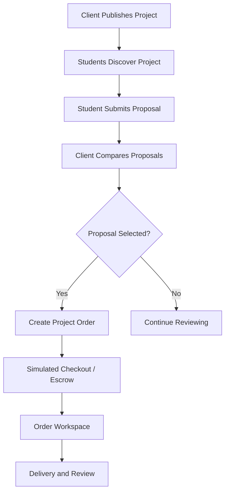

---
title: Projects and Proposals Module
type: module
status: planned
tags: [MIU, projects, proposals]
---

# Projects and Proposals

## 1. Purpose

Support the project-based freelancing model inspired by Mostaql.

Clients publish projects and student freelancers compete through proposals.

**SRS references:** FR-S04–FR-S06, FR-C04–FR-C06.

## 2. Client Project Management

Clients can:
- Create a project
- Edit a project
- Preview a project
- Publish a project
- Close a project
- Cancel a project when permitted
- Review incoming proposals

## 3. Project Information

A project should include:
- Title
- Description
- Category/required skills
- Scope and expected deliverables
- Budget in EGP
- Deadline
- Publication status

Additional fields may be defined during UI review.

## 4. Student Discovery

Students can:
- Browse projects
- Search by text
- Filter relevant results
- Open project details
- View planned recommendations
- Submit a proposal if eligible

## 5. Proposal Submission

A proposal contains:
- Proposed price in EGP
- Delivery time
- Cover message
- Permitted attachments

Validation should cover required fields, valid amounts, and applicable project state.

## 6. Proposal Management

Students can:
- View submitted proposals
- Check proposal status
- Edit a proposal while allowed
- Withdraw a proposal while allowed

## 7. Client Proposal Review

Clients can:
- View incoming proposals
- Compare price and delivery time
- Review the student profile
- Shortlist proposals
- Accept or reject proposals

Acceptance should lead into the appropriate project order workflow.

## 8. Proposed Workflow

## 9. Pricing Rule

All project budgets and proposal prices are in EGP.

Whether the platform blocks proposals outside a client's specified budget or merely displays a warning is not yet finalized.

## 10. Potential Statuses

Suggested workflow labels:
- Draft
- Open
- Under Review
- Selected
- Closed
- Cancelled

Proposal status may include:
- Submitted
- Shortlisted
- Accepted
- Rejected
- Withdrawn

These exact enums require approval before persistence design.

## 11. Phase 1 Expectations

Demonstrate:
- Browse/search/filter
- Project details
- Post/edit project
- Proposal form
- Proposal list
- Client comparison
- Mock acceptance
- Transition to a mock project order

**Current frontend status (22 October 2026):** The projects catalogue has a
standalone responsive React preview. Its current visual direction draws on
the MIU admission-screen reference: centered branding, a warm neutral canvas,
a category rail, and one crimson-accented listing panel. It shows fictional
open-project rows, search, category/budget/skill filters, sorting, active
filter chips, an empty state, brief disclosure, and temporary saved-item state.
The filters stack on smaller screens. Saving is not persistent.
Project detail pages, proposal actions, role restrictions, and router
integration are still pending.

## 12. Dependencies

- Authentication
- Student/client roles
- Profiles
- Skills matching
- Orders
- Payments and escrow
- Notifications
- Marketplace moderation

## Related Documents

- [Services and Orders](SERVICES_AND_ORDERS.md)
- [Payments and Escrow](PAYMENTS_AND_ESCROW.md)
- [Business Rules](../02-REQUIREMENTS/BUSINESS_RULES.md)
